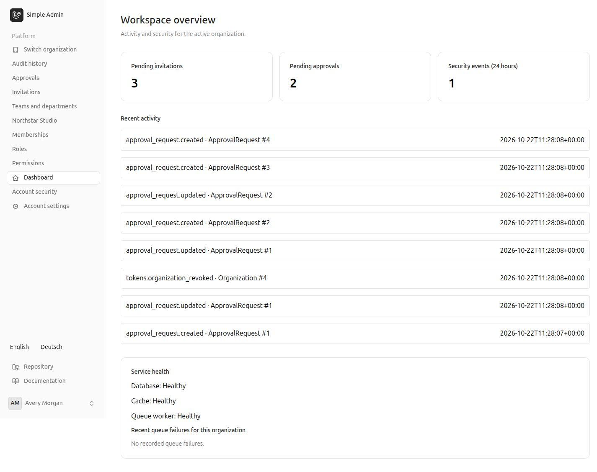
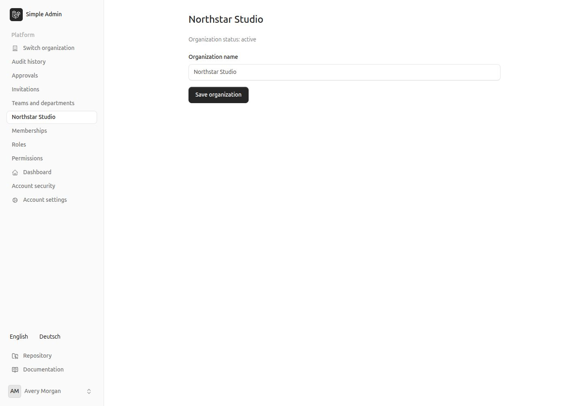
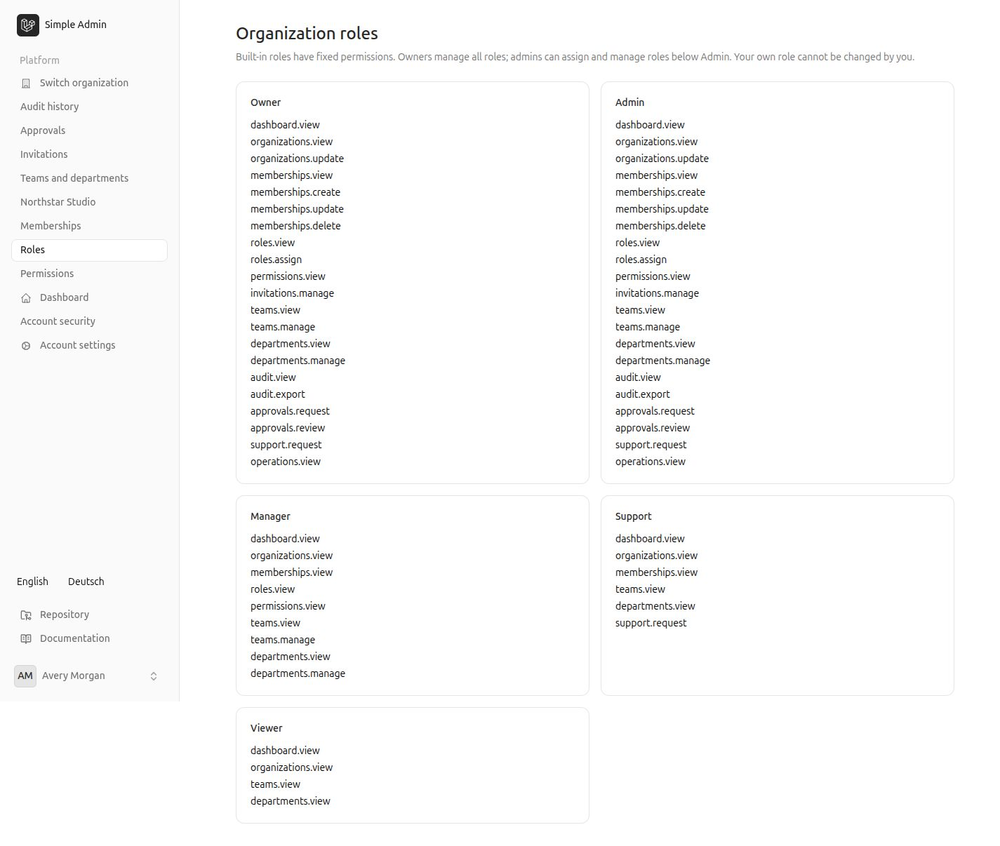
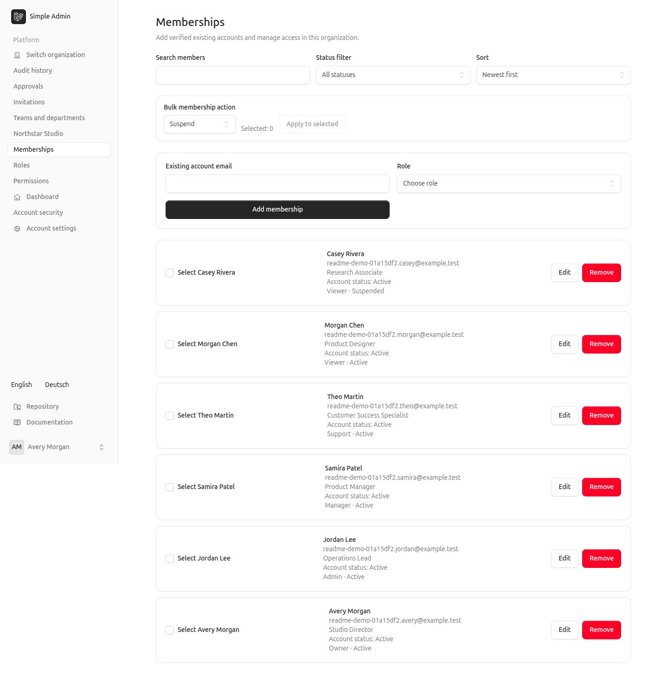
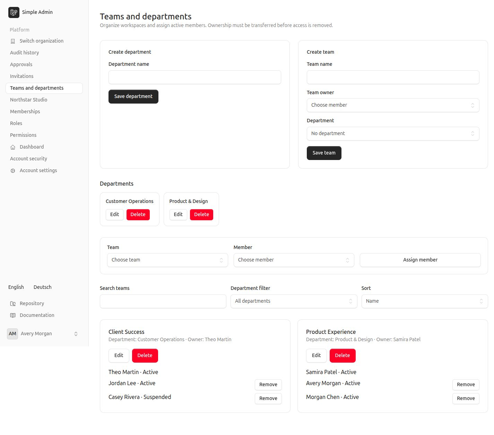
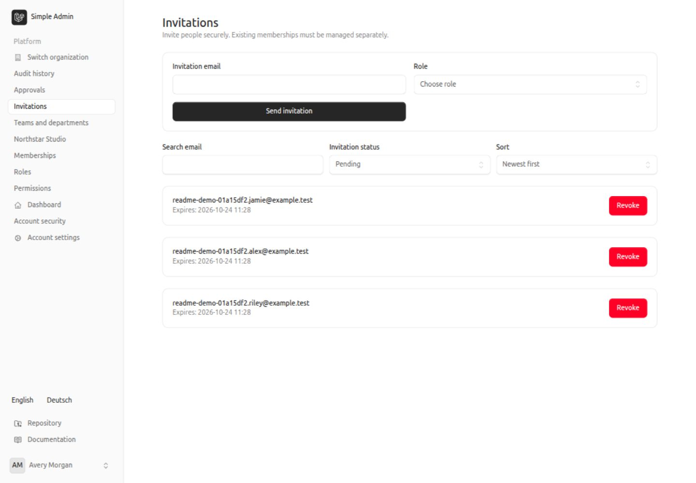
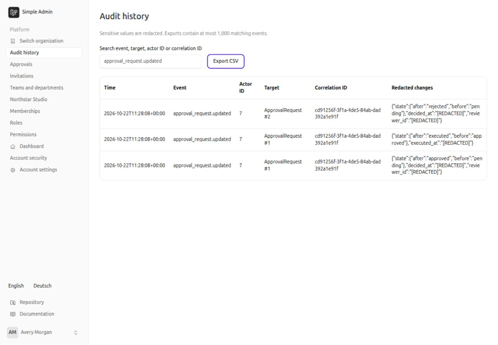
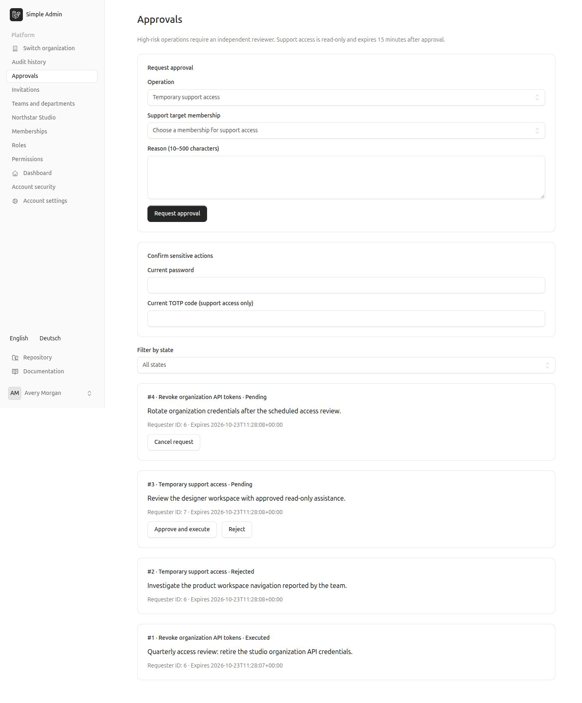
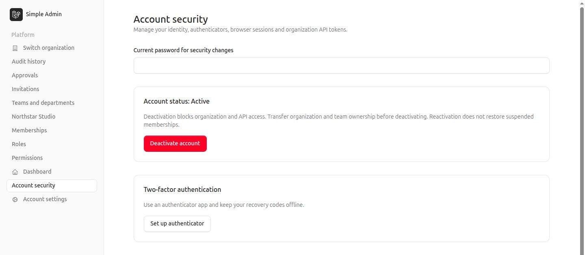
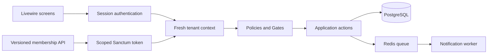

# Simple Admin — Enterprise Multi-Tenant Administration Platform

An administration workspace for managing organizations, people, and access from one application. Teams can invite colleagues, assign responsibilities, review sensitive requests, and trace administrative activity while keeping each organization's data separate.

Built with Laravel and Livewire, this portfolio project demonstrates secure identity management, tenant-aware authorization, and tested governance workflows. It modernizes a legacy Laravel 5.6 application while preserving its Git history and documenting migration limits.


[](https://github.com/dionis1/simple-admin/actions/workflows/ci.yml)

[Features](#key-features) · [Engineering](#engineering-highlights) · [Run locally](#getting-started) · [Verification](#testing-and-quality) · [Documentation](#technical-documentation)

## Application Screenshots

Real screens from the local Docker application using an entirely synthetic **Northstar Studio** workspace. These are application captures, not design mockups. Click an image to inspect it at full size.



**Dashboard overview.** Permission-scoped activity, invitations, approvals, security events, and service health in one place.

| Organizations & people | Access & structure |
| --- | --- |
| [](docs/screenshots/organizations.jpg) | [](docs/screenshots/roles-permissions.jpg) |
| **Organization management** — manage the active workspace. | **Roles & permissions** — inspect the fixed access catalog. |
| [](docs/screenshots/users.jpg) | [](docs/screenshots/teams-departments.jpg) |
| **Memberships** — search, filter, and administer organization access. | **Teams & departments** — organize people and assign team ownership. |

| Invitations & governance | History & account security |
| --- | --- |
| [](docs/screenshots/invitations.jpg) | [](docs/screenshots/audit-history.jpg) |
| **Invitations** — track pending invitations and their expiry. | **Audit history** — inspect sensitive changes with tenant-scoped access. |
| [](docs/screenshots/approvals.jpg) | [](docs/screenshots/account-security.jpg) |
| **Approvals** — review requests for supported high-risk operations. | **Account security** — inspect account status and the TOTP enrollment entry point. |

[Capture details, additional screens, and visual verification limits](docs/screenshots/README.md).

## Key Features

| Area | What users can do |
| --- | --- |
| Organizations | Belong to multiple organizations and switch between authorized workspaces. |
| Membership administration | Invite, edit, suspend, deactivate, and reactivate memberships; perform permission-checked bulk operations. |
| Access control | Assign Owner, Admin, Manager, Support, or Viewer roles; inspect resource/action permissions. |
| Invitations & security | Use expiring invitations, verified email, password resets, TOTP, recovery codes, and session revocation. |
| Teams & departments | Group memberships into departments and teams with designated team owners. |
| Approval workflows | Request independent approval for organization-wide API-token revocation or temporary support access. |
| Audit & support | Search redacted audit events, export permitted CSV data, and use approved, time-limited, read-only support views. |
| Dashboard & filtering | Review workspace activity and security events; search, filter, sort, and paginate management lists. |
| API & localization | Use scoped, expiring Sanctum tokens for membership API endpoints; switch between English and German. |

## Engineering Highlights

The engineering decisions are backed by implementation and behavioral tests:

| Design decision | Why it matters | Evidence |
| --- | --- | --- |
| Fresh tenant context | Rechecks identity and active membership; browser-supplied IDs never establish authority. | [Tenant context tests](tests/Feature/Tenancy/TenantContextTest.php) |
| Tenant-aware policies | Combines resource permissions, membership status, and role hierarchy on the server. | [Permission matrix](tests/Feature/Tenancy/PermissionMatrixTest.php) · [Tenancy design](docs/tenancy.md) |
| Privilege-escalation prevention | Blocks self-promotion, unauthorized assignments, and removal of the final active owner. | [Membership security](tests/Feature/Tenancy/MembershipSecurityTest.php) · [Owner concurrency](tests/Feature/Tenancy/OwnerConcurrencyTest.php) |
| PostgreSQL integrity constraints | Composite foreign keys and unique constraints prevent invalid cross-tenant relationships. | [Database constraint tests](tests/Feature/Tenancy/DatabaseConstraintsTest.php) |
| Transaction-safe operations | Row locks protect sensitive changes; approval effects and audit records commit or roll back together. | [Approval tests](tests/Feature/Governance/ApprovalsTest.php) · [Governance races](tests/Feature/Governance/ConcurrencyTest.php) |
| Automated security testing | Exercises revoked access, invitation/MFA single use, audit redaction, and support-session boundaries. | [Credential races](tests/Feature/Identity/ConcurrentCredentialsTest.php) · [Audit](tests/Feature/Governance/AuditTest.php) · [Support access](tests/Feature/Governance/ImpersonationTest.php) |
| Continuous integration & quality | Checks formatting, static analysis, tests, frontend assets, and dependency advisories. | [CI workflow](.github/workflows/ci.yml) · [Current results](#testing-and-quality) |
| Explicit threat boundaries | Documents what is protected, what requires operational controls, and what remains unverified. | [Threat model](docs/threat-model.md) |

Concurrency tests use independent PHP processes and real PostgreSQL lock waits. Authorization is enforced through the current membership rather than a global administrator bypass. CI is implemented; automated production deployment is outside this repository's scope.

## Architecture Overview

A **modular monolith**: one Laravel application, one PostgreSQL database, and cohesive modules for tenancy, identity, and governance. Livewire screens and API controllers handle transport; policies decide access; focused actions coordinate business rules and transactions.



Fortify supplies authentication and TOTP. Tailwind CSS 4, Flux UI, and Vite 8 support the interface. Redis provides cache and queues; PostgreSQL stores identities, memberships, sessions, and audit history.

See the [architecture map and modernization decisions](docs/architecture.md) and [contributor conventions](AGENTS.md).

## Getting Started

**Prerequisite:** Docker Engine/Desktop with Compose v2. Host PHP and Node installations are unnecessary. Docker runs PHP 8.4; PHP 8.3 is the minimum Composer/CI target.

For a **new local installation**:

```bash
git clone https://github.com/dionis1/simple-admin.git
cd simple-admin
cp .env.example .env
# Linux: set LOCAL_UID / LOCAL_GID in .env if your IDs differ from 1000.
docker compose build app
docker compose up -d postgres redis
docker compose run --rm --no-deps app composer install
docker compose run --rm --no-deps app php artisan key:generate
docker compose run --rm app php artisan migrate
docker compose run --rm --no-deps node npm ci
docker compose run --rm --no-deps node npm run build
docker compose up -d app worker
```

Open [localhost:8000](http://localhost:8000), then:

1. Register a new account. There are no default accounts or passwords.
2. Verify your email using the link in the private `storage/logs/laravel.log` file. Local mail is logged; it is not delivered to an inbox.
3. Create an organization to become its initial Owner, or accept an invitation from an authorized administrator.
4. Select the organization to access its dashboard and permitted management screens.

```bash
# Stop services and release RAM while preserving database volumes.
docker compose down
# Resume the existing installation.
docker compose up -d app worker
```

Keep `.env`, `APP_KEY`, and logged verification links private. Do not overwrite an existing `.env`, regenerate its key, or delete volumes as an update procedure. Existing production data requires a separate migration plan: read [legacy data limitations](docs/legacy-data.md) first.

[Detailed local setup, mail, frontend development, and updates](docs/local-development.md).

## Testing and Quality

**Local verification rechecked on 2026-10-22:** **309 tests / 836 assertions**, Pint, and Larastan level 7 passed through Docker `composer check`. Migration status and Redis connectivity also passed. The earlier [four-phase review](docs/phases-review.md) additionally records frontend lint/build, dependency scans, and view compilation; those checks were not repeated for this documentation-only update. These are dated results, not a coverage percentage or a production-readiness claim.

**Remote CI:** an [earlier recorded run on commit `73c6936`](https://github.com/dionis1/simple-admin/actions/runs/39768845496) reported a Pint formatting failure. This documentation review did not recheck remote run results. Consult the live badge and linked workflow for current status; local success does not establish a green GitHub run.

**CI formatting follow-up:** a fresh-cache Pint run reproduced `method_argument_space` failures in two identity test files that the earlier cached local check missed. Four calls were formatted, and a second fresh-cache check passed across all 161 PHP files. The fix still requires a pushed GitHub Actions run to confirm remote success.

Tests use the dedicated **`simple_admin_testing`** database and reset its schema. Fresh Docker volumes create it automatically; see [test database setup](docs/local-development.md#tests-use-a-separate-database) for existing volumes. Never run these tests against application or production data.

```bash
docker compose exec app composer check
docker compose exec app composer audit --locked --no-interaction
docker compose run --rm --no-deps node npm ci
docker compose run --rm --no-deps node npm run lint
docker compose run --rm --no-deps node npm run build
docker compose run --rm --no-deps node npm audit --audit-level=low
docker compose exec app php artisan view:cache
docker compose exec app php artisan app:check-redis
```

| Tool | Purpose |
| --- | --- |
| Pest 4 + starter-kit PHPUnit tests | HTTP, Livewire, authentication, tenant boundaries, negative cases, and concurrency. |
| Laravel Pint | PHP formatting checks. |
| Larastan level 7 | Static analysis of application code. |
| ESLint + Vite | JavaScript/config lint and frontend production build. |
| Composer/npm audit | Time-specific dependency advisory checks, including development dependencies. |
| GitHub Actions | Repeats quality gates with PHP 8.3, PostgreSQL, and Redis. |

The [screenshot verification record](docs/screenshots/README.md) describes this documentation update's browser checks. It does not replace the automated security suite.

## Technical Documentation

| Guide | Contents |
| --- | --- |
| [Architecture](docs/architecture.md) | Module boundaries, directory map, and modernization decisions. |
| [Tenancy & authorization](docs/tenancy.md) | Role matrix, policies, ownership rules, and tenant isolation. |
| [Identity management](docs/identity.md) | Invitations, membership lifecycle, teams, MFA, sessions, and API tokens. |
| [Governance](docs/governance.md) | Audit guarantees, approval states, support restrictions, and exact workflow scope. |
| [Threat model](docs/threat-model.md) | Trust boundaries, mitigations, and residual risks. |
| [API examples](docs/api-examples.md) | Scoped authentication and membership request/response examples. |
| [Local development](docs/local-development.md) | Installation, mail, assets, testing, and safe updates. |
| [Operations](docs/operations.md) | Deployment prerequisites, health/logs, backup restoration, and migration safety. |
| [Legacy data](docs/legacy-data.md) | Preserved migration identities and limitations of importing existing data. |
| [Four-phase review](docs/phases-review.md) | Implementation evidence and verification boundaries across all four phases. |
| [Contribution conventions](AGENTS.md) | Architecture, security rules, and verification commands. |

## Project Status and Limitations

- [x] Phase 1 — Modern foundation
- [x] Phase 2 — Multi-tenancy & RBAC
- [x] Phase 3 — User management & security
- [x] Phase 4 — Governance & deployment guidance

These phases describe the implemented application scope. The repository is a portfolio project with local verification, not a certified production service.

- **Fixed roles:** the five role catalogs are read-only; a custom-role builder and organization suspension/deletion screens are not implemented.
- **Scoped administration:** administrators manage organization memberships, not another person's global identity across unrelated organizations.
- **Bounded approvals:** independent approval covers organization-wide token revocation and support access. Ordinary membership changes use their existing policies and ownership safeguards.
- **Restricted support:** approved views are read-only, bound to one browser session, and expire 15 minutes after approval. Starting requires a fresh password and confirmed TOTP.
- **Audit limits:** supported application paths are audited; database superusers and arbitrary SQL are outside these guarantees. Retention/erasure policy needs an operational decision.
- **Outstanding verification:** current remote CI status was not rechecked during this documentation review. Production deployment, external SMTP, legacy production import, load testing, and a full disaster-recovery drill remain unverified. A local database restore rehearsal is recorded in [Phase 4 verification](docs/phase-4-verification.md).
- **Future scope:** business modules, analytics, custom roles, and production deployment automation are not included. Docker Compose is for local development.
